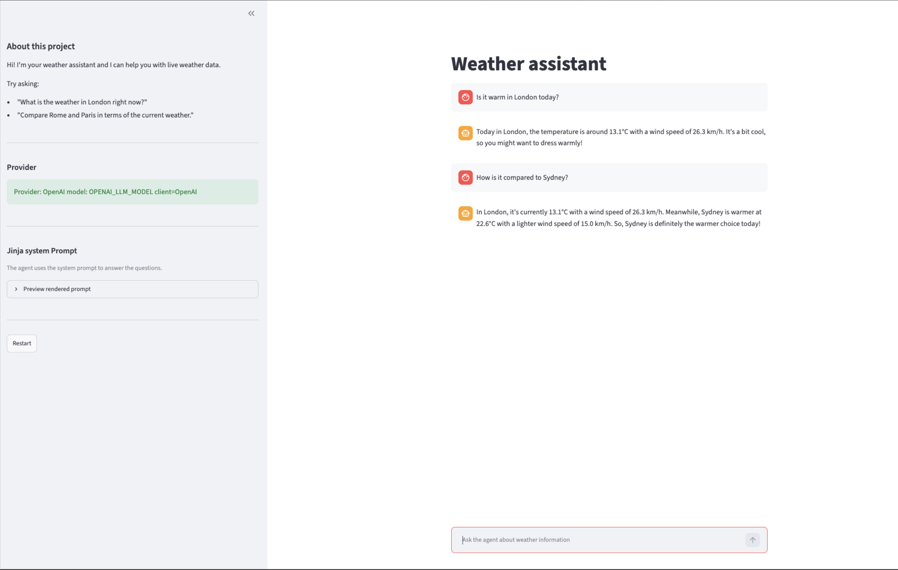

# WeatherAssistant 🌤️

An interactive, multi-turn AI agent that fetches real-time weather conditions for any city in the world. Built with OpenAI, Jinja2 templating, and Streamlit, this agent features conversational memory and dynamic tool execution to answer complex, comparative weather queries.



## Features

* **Multi-Turn Agent Loop:** Autonomously executes multiple tool calls before synthesizing a final response.
* **Conversational Memory:** Remembers context across interactions for a natural chat experience.
* **Jinja2 Prompt Management:** Decouples prompt engineering from application logic, rendering system instructions and tool schemas dynamically.
* **Live Weather Data:** Integrates with the Open-Meteo API (no API key required) for real-time temperature and wind speed.
* **Streamlit Web UI:** A clean, responsive chat interface with a sidebar for inspecting the provider, model, and active system prompt.

## Project Structure

```text
WeatherAssistant/
├── app.py                   # Streamlit frontend UI
├── index.py                 # Terminal/CLI entry point
├── llm/                     # Core AI engine
│   ├── __init__.py
│   ├── config.py
│   ├── factory.py
│   ├── models.py
│   └── prompt_manager.py
├── templates/               # Jinja2 prompt files
│   ├── greeting.jinja
│   └── system.jinja
├── tools/                   # External capabilities
│   ├── __init__.py
│   └── weather/             # Open-Meteo API integration
│       ├── __init__.py
│       ├── api.py
│       └── schema.py
├── .env                     # Environment variables
├── .env.example             
├── .gitignore               
├── .python-version          
├── pyproject.toml           # Package dependencies
├── README.md                
└── uv.lock                  # Dependency lockfile

## Setup & Installation

1. **Clone the repository and install dependencies:**

   This project uses `uv` for package management.
2. **Configure Environment Variables:**

   Create a `.env` file in the root directory and add your LLM API keys:
3. **Run the Application:**
   * **Web Interface:** `streamlit run app.py`
   * **Terminal Interface:** `python index.py`
```